# Dear Selly · 디어셀리

> Held, not healed. — 나를 돌보는, 작은 웰니스 정원

캐릭터 육성형 웰니스 웹앱 MVP.

- **Phase 1** — 인터랙티브 유리온실 홈 화면 (셀리, 터치, 호흡하기, 돌보기)
- **Phase 2** — 오늘의 기록 · 생리주기 캘린더/주기 분석 · 웰니스 리포트 (기기 내 저장)
- **Phase 3** — 셀리 육성 루프: 성장 단계 · 오늘의 돌봄 · 레벨업 · 설정
- **Phase 4** — 앱으로 설치(PWA): 셀리 아이콘 · 전체 화면 실행 · 오프라인 · 설치 안내, 기록 파일 가져오기
- **Phase 5** — 호흡하기 고도화: 패턴 4종 · 1/3/5분 · 멈춤 단계 · 소리/진동 신호
- **Phase 6** — 소리: 배경 음악 "온실 오르골" · 셀리 효과음
- **Living Greenhouse 2.0 · Phase A** — 살아 있는 셀리: 자율 행동 상태 머신 · 온실 바닥 이동 · 시간대별 행동
- **셀리와 함께 산책 (웹 1단계)** — 온실 문 → 산책길 → 셀리 걷기 → 마음 산책/움직임 감지 → 요약 → 온실 복귀
- **Phase B · 셀리와 이야기하기** — 선택형 대화(말풍선 + 선택지 4개), 선택에 따라 셀리의 말과 행동이 달라짐
- **시간대별 온실 조명** — 아침 · 낮 · 저녁 · 밤 빛 연출, 자동 또는 직접 선택
- **Phase C · 기분 정원** — 마음의 색 기록 → 5색 꽃이 온실 화단에 심어지고 자라요(시들지 않음)
- **Phase D · 온실 꾸미기** — 정해진 자리에 아이템 놓기 · 바꾸기 · 치우기 · 저장
- **Phase E · 개인화된 돌봄 제안** — 기록·주기·시간대로 셀리가 하루 한 번 쉬어갈 방법을 제안, 조용한 온실 모드
- **온실 나누기** — 셀리 엽서 이미지 공유, 서버 없는 온실 구경 링크
- **친구 (Supabase + 카카오 로그인)** — 초대 코드로 친구 맺기, 친구 온실 구경, 미리 준비된 선물 주고받기

```bash
npm install
npm run dev   # http://localhost:3000  (모바일 390×844 기준)
```

Next.js 16 (App Router) · TypeScript · Tailwind CSS v4 · Motion for React · Lucide.
폰트는 `@fontsource`로 셀프 호스팅합니다(Gowun Dodum, Parisienne).

## 1. 레퍼런스 분석

| 항목 | 정리 |
| --- | --- |
| 레이아웃 (390×844) | 로고 + 알림/설정 (y≈76) → 레벨 카드 + 성장 배지 (y≈122–187) → 말풍선 (y≈306–391) → 셀리 + 잔디 섬 (y≈404–636) → 액션 독: 기록하기 / 호흡하기(원형, 핑크) / 셀리 돌보기 (y≈624–752) → 하단 내비 (y≈761–838) |
| 팔레트 | `#FDFBF6` `#F6EEDB` `#E8F3E7` `#D9E8D2` `#B7D4B0` `#8FAF91` + 블러시 `#EFBCBF` `#E6A3A8`, 잉크 `#4A3F36` |
| UI | 반투명 크림 글래스 카드, 큰 라운드(24–30px), 부드러운 그림자, 듀오톤 일러스트 아이콘, 활성 탭 세이지 그린 |
| 셀리 | 크림색 둥근 몸통, 복슬복슬한 외곽, 연두 잎 두 장(V자), 작은 눈·ω 입, 분홍 볼, 배 쪽 따뜻한 발광, 작은 팔·발 |
| 배경 | 돔형 유리 천장(방사형 서까래), 아치 창 격자, 위에서 내려오는 덩굴, 좌측 나무 선반(화분·책·액자), 매달린 랜턴, 우측 테이블, 햇살 광선, 이끼 바닥 |

## 2. 구조

```
src/components/
  greenhouse/  GreenhouseBackground (6개 깊이 레이어 SVG), DustMotes, svg-kit
  selly/       Selly (floater → jumper → breather 레이어), SellyBody, SellyFace, SellyEffects
  home/        HomeScreen, TopBar, LevelCard, SpeechBubble, ActionDock, CareSheet, GrassMound
  breathing/   useBreathingSession (rAF, 4s/4s, 60s), BreathingControls, BreathingSession
  layout/      MobileFrame, BottomNav
  screens/     RecordScreen(임시 UI), ComingSoon, SubPage
src/lib/       selly-store (레벨/경험치, 반응 이벤트, 호흡 MotionValue), assets (에셋 슬롯)
```

모든 텍스트·버튼·캐릭터·이펙트는 독립 컴포넌트입니다. 배경 이미지 위에 투명 버튼을 얹은 방식이 아닙니다.

## 3. 구현된 상호작용

- **Idle**: 천천히 떠오르기, 숨쉬듯 늘어나고 줄어드는 몸, 잎 흔들림, 무작위 눈 깜빡임(가끔 두 번)
- **Greeting**: 접속 시 "오늘도 잘 쉬어가고 있지? ♡" + 인사 동작
- **Touch**: 찌그러짐 → 점프 → 착지 바운스, 웃는 얼굴, 반짝임, 대사 순환, 경험치 +1
- **호흡하기**: 4초 들숨 / 4초 날숨 / 1분. 셀리 크기·잎 벌어짐·후광이 호흡에 맞춰 움직임. 일시정지·재개·종료, 완료 시 +20
- **셀리 돌보기**: 물 주기(물방울 → 잎이 쫑긋), 햇빛 주기(따뜻한 빛), 쓰다듬기(하트)
- **내비게이션**: 홈 / 기록(임시 기록 UI, 저장하지 않음) / 캘린더·리포트(준비 중 화면)
- `prefers-reduced-motion` 지원

## 4. 에셋

원본 아트는 `assets-src/`에 있고, `scripts/extract-assets.py`로 웹용 에셋을 만듭니다.

```bash
pip install pillow numpy opencv-python-headless
python3 scripts/extract-assets.py
```

| 결과물 | 처리 |
| --- | --- |
| `public/assets/selly/selly-body.png` | 캐릭터 시트의 메인 포즈를 알파로 분리, 반투명 글로우 배경 제거, **눈·입 인페인팅 제거**(볼 터치는 유지) |
| `public/assets/selly/selly-leaf-left/right.png` | 잎 두 장을 별도 레이어로 분리 → 흔들림, 호흡 시 벌어짐, 물 주기 반응 |
| `public/assets/greenhouse/greenhouse-bg.webp` | 온실 배경 (하단 흰 여백 제거) |
| `public/assets/greenhouse/grass-island.png` | 배경의 잔디 패치를 잘라 셀리가 앉는 자리로 사용 |

얼굴은 벡터 레이어(`SellyFace`)로 그 위에 올려 눈 깜빡임과 표정(기본/웃음/편안함)을 유지합니다.
스크립트가 출력하는 얼굴 위치·잎 회전축 값은 `src/lib/assets.ts`에 들어 있습니다.
슬롯을 `null`로 바꾸면 벡터 대체 그래픽으로 돌아갑니다.
다음 단계에서 3D(React Three Fiber)로 바꿀 때는 `SellyBody`만 교체하면 됩니다.

## 5. Phase 2 — 기록 · 생리주기 · 리포트

| 화면 | 내용 |
| --- | --- |
| 오늘의 기록 `/record` | 날짜 이동(과거 기록 수정), 기분 5단계, 컨디션 4종(에너지·수면·집중·스트레스) 5단계, 걸음 수(수동 입력), 메모. 오늘 첫 기록 시 성장 +15 |
| 생리주기 `/calendar` | 월 달력: 생리일(이어진 분홍 띠) · 가임기 · 배란 예정일 · 생리 예정일(점선) · 기록 있는 날. 날짜를 누르면 생리일 표시, "시작일부터 n일 한 번에 표시", 그날 기록 보기/수정. 현재 주기 카드, 주기 분석(평균 주기·기간, 다음 예정일, 최근 주기 길이, 생리 기록) |
| 리포트 `/report` | 주간·월간·전체. 요약 문장(직전 기간과 비교), 주요 밸런스 레이더(기분·에너지·수면·집중·마음 여유, 3개 미만이면 막대로 전환), 기분 흐름(주간은 얼굴, 월간·전체는 선 그래프 + 터치 툴팁), 기록한 날·평균 걸음 수 |

- **저장:** `src/lib/data-store.ts`. 브라우저 `localStorage`에만 저장하고 서버로 보내지 않아요. 셀리 레벨과 경험치도 여기에 저장돼요. 나중에 백엔드를 붙일 때는 `load`/`persist`만 바꾸면 돼요.
- **주기 예측:** `src/lib/cycle.ts`. 달력 계산법을 써요. 최근 6회 평균 주기를 쓰고, 기록이 없으면 28일로 계산해요. 배란일은 다음 시작일 − 14일, 가임기는 배란일 −5일 ~ +1일이에요. 참고용 안내 문구를 함께 표시해요.
- **차트 색:** 캘린더 표시 색은 색약 시뮬레이션과 일반 시야 구분 검증을 통과했어요. 색 말고 모양(띠·원·링·점선)으로도 구분돼요.
- **예시 데이터:** 기록이 하나도 없을 때 리포트에서 "예시 데이터로 둘러보기"를 누르면 약 10주치 데이터가 들어가요. 배너에서 지울 수 있어요.

## 6. Phase 3 — 셀리 육성 루프

| 기능 | 내용 |
| --- | --- |
| 성장 단계 `src/lib/growth.ts` | 씨앗(Lv.1) → 새싹(Lv.3) → 잎새(Lv.5) → 꽃피움(Lv.10). 분리해 둔 잎 레이어를 활용해요. 씨앗은 작은 떡잎, 새싹은 잎 60%, 꽃피움은 꽃 화관이고, 어린 단계일수록 몸집이 작아요. 레벨당 500 |
| 오늘의 돌봄 | 기록 +15 · 1분 호흡 +20 · 물 +10 · 햇빛 +10 · 쓰다듬기 +5. **하루 한 번씩만** 성장으로 이어지고, 다 하면 보너스 +20. 셀리 터치는 하루 +10까지 |
| 셀리의 성장 `/growth` | 현재 단계, 4단계 트랙, 다음 단계까지 남은 성장, 오늘의 돌봄 체크리스트(누르면 홈에서 호흡이나 돌보기가 바로 열림). 홈의 레벨 카드와 배지에서 들어가요. 배지 링은 오늘의 돌봄 진행률이에요 |
| 레벨업 | 레벨이 오르면 축하 화면을 띄우고, 단계가 바뀌면 새 모습과 단계 설명을 보여줘요 |
| 설정 `/settings` | 내 데이터 현황, JSON 내보내기, 모든 데이터 지우기(확인 창), 앱 정보·안내 |

새 사용자는 **Lv.1 씨앗**부터 시작해요. 기존 사용자는 저장된 레벨을 그대로 유지해요.

## 7. Phase 4 — 앱으로 설치 (PWA)

- `src/app/manifest.ts`: 이름 "디어셀리", standalone, 세로 고정, 바로가기(기록 · 호흡 · 생리주기)
- 아이콘: `scripts/extract-assets.py`가 시트 원본(얼굴 포함)으로 생성해요. 일반 / 마스커블(안전 영역 80%) / `apple-icon.png` / `icon.png`
- iOS: `apple-mobile-web-app-*` 메타, 상태바 투명(safe-area 패딩으로 대응)
- `public/sw.js`: 페이지는 네트워크 우선이고 오프라인이면 캐시를 써요. 빌드 파일과 아트는 캐시 우선이에요. 프로덕션에서만 등록돼요. 그림 에셋을 바꾸면 `VERSION`을 올려 주세요
- 설치 후에는 `navigator.storage.persist()`로 브라우저가 기기 내 기록을 지우지 않도록 요청해요
- 설정의 "앱으로 설치하기": 안드로이드는 설치 버튼, iOS는 공유 → 홈 화면에 추가 안내, 설치된 경우 "실행 중" 표시

### 기록 파일 가져오기 (`src/lib/backup.ts`)
- 설정 → **기록 파일 가져오기**로 내보낸 JSON을 불러와요. 다른 기기나, iOS에서 Safari ↔ 홈 화면 앱 사이로 옮길 때 써요
- 불러오기 전에 내용(기록한 날 · 생리 기록 · 레벨 · 기간)을 보여주고, **합치기**(같은 날은 최근 수정본 우선, 생리일은 합집합, 성장은 높은 쪽) 또는 **덮어쓰기**를 고를 수 있어요
- 파일은 신뢰하지 않는 입력으로 다뤄요. 날짜 형식, 1~5 범위, 걸음 수 범위, 메모 길이, 레벨과 경험치를 검사하고 맞지 않는 값은 버려요. 5MB가 넘는 파일은 받지 않아요

## 8. Phase 5 — 호흡하기 고도화 (`src/lib/breathing.ts`)

| 패턴 | 리듬(초) | 설명 |
| --- | --- | --- |
| 편안한 호흡 | 4 · 4 | 처음이라면 여기서부터 |
| 길게 내쉬기 | 4 · 6 | 긴장을 천천히 풀어요 |
| 4-7-8 호흡 | 4 · 7 · 8 | 잠들기 전에 좋아요 |
| 박스 호흡 | 4 · 4 · 4 · 4 | 마음을 가지런히 |

- 호흡하기를 누르면 **준비 화면**이 열려요. 패턴, 시간(1·3·5분), 소리, 진동을 고르고, 선택은 기억돼요. 세션은 호흡 중간에 끊기지 않도록 사이클 단위로 반올림해요
- 멈춤 단계에서는 셀리가 부푼 채(또는 가라앉은 채) 멈춰 있어요. 말풍선과 링이 단계마다 바뀌어요
- 소리는 오디오 파일 없이 WebAudio로 만든 짧은 차임이에요(기본 꺼짐). 진동은 지원 기기(안드로이드)에서만 써요
- 고친 버그: 호흡 중 셀리가 미세하게 흔들리던 문제(반복 설정이 남아 있던 원인), 세션 종료 직후 완료 문구가 덮이던 문제

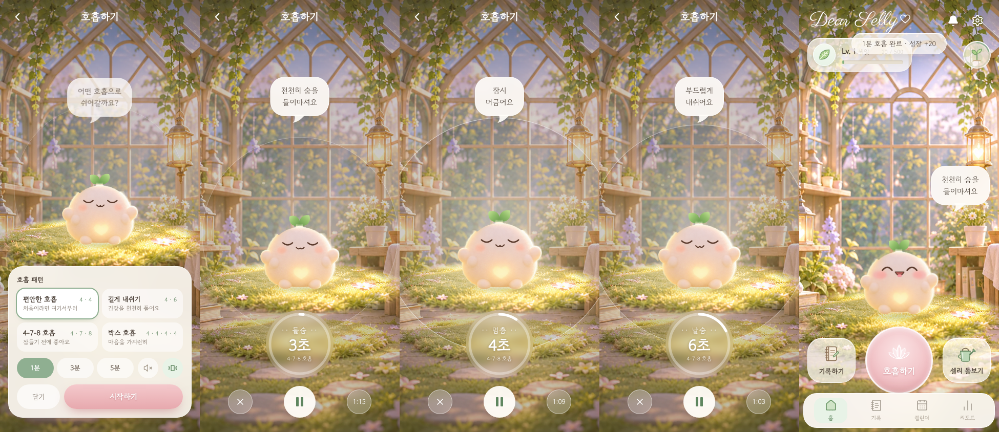

## 10. Living Greenhouse 2.0 — Phase A: 살아 있는 셀리

사용자가 아무것도 하지 않아도 셀리가 온실에서 스스로 생활해요.

| 파일 | 역할 |
| --- | --- |
| `src/data/greenhouseWorld.ts` | 월드 데이터. 좌표는 **배경 그림 픽셀(1086×1301)** 이에요. 볼록 다각형 이동 영역(책 더미·테이블 다리·앞쪽 꽃 회피), 장소(방석·창가·꽃밭·화분·랜턴), 원근 크기 |
| `src/data/sellyDialogues.ts` | 규칙 기반 대사(인사·터치·돌봄·행동별 혼잣말·부르기·깨우기). 데이터만 추가하면 늘어나요 |
| `src/lib/game/world.ts` | 화면 ↔ 월드 좌표 변환. 바닥 앞쪽 가장자리를 홈 버튼 바로 위에 맞추는 배치 계산, 이동 영역 보정 |
| `src/lib/game/behaviorEngine.ts` | 상태(idle · walking · looking_at_flower · watering · sunbathing · sitting · sleeping · greeting · interacting · breathing)와 활동 선택. 시간대별 가중치, 같은 활동 연속 금지 |
| `src/lib/game/gameStore.ts` | 게임 저장소(**웰니스 기록과 분리**). 지금은 마지막 방문만 저장해요. 오랜만에 와도 반갑게만 인사하고 벌칙은 없어요 |
| `src/components/selly/useSellyBrain.ts` | 상태 머신. 한 번에 한 활동만 실행해요. 걷기(통통 튀는 걸음, 방향 전환), 떠오르기(호흡), 상호작용 시 즉시 중단했다가 다시 시작 |
| `src/components/greenhouse/GreenhouseWorld.tsx` | 월드 렌더링. 원근 크기, 따라다니는 말풍선, 잠자기 Zz, 화분 돌보기 물방울, 앉기와 잠들기 자세, 호흡 후광, 바닥 터치로 셀리 부르기 |

- 시간대(기기 현지 시간) 가중치
  - 아침: 창가 햇볕
  - 낮: 산책·꽃 구경·화분
  - 저녁: 방석에 앉기·랜턴
  - 밤: 잠자기
- 동작 줄이기 설정: 걸어 다니지 않고 방석에서 앉기·잠자기·바라보기만 해요
- 향후 3D: 월드 좌표 (x, y)를 3D 바닥 평면 (x, z)로 옮기면 돼요. 행동 엔진과 대사 데이터는 그대로 써요


### 새 에셋 적용 (오브젝트 · 셀리 포즈 · 꽃)

`scripts/extract-objects.py`가 `assets-src/`의 원본을 정리해요. 가장자리의 노랑·빨강 번짐을 정리하고, 시트를 자르고, 쿠션 앞 테두리 레이어와 씨앗 단계용 맨머리 포즈를 만들어요.

| 오브젝트 (`src/data/greenhouseObjects.ts`) | 위치 | 터치하면 |
| --- | --- | --- |
| 꽃 쿠션 | 바닥 가운데 | 셀리가 걸어와서 함께 쉬어요(앉기). 자율 행동의 앉기·낮잠도 여기서 해요 |
| 빛나는 구슬 | 왼쪽 앞 | 호흡하기 |
| 온실 캘린더 | 오른쪽 테이블 위 | 생리주기 화면 |
| 기분 꽃 | 오른쪽 앞 | 기록 화면. 기분을 기록한 날 수로 씨앗(0) → 새싹(1) → 꽃봉오리(3) → 개화(7)로 자라고, 시들지 않아요 |

- **깊이 정렬:** 셀리와 오브젝트를 바닥 y 순서로 겹쳐 그려요. 쿠션은 뒤판과 앞 테두리로 나뉘어 있어서, 셀리가 들어가 앉으면 앞 테두리가 셀리를 가려요
- **셀리 포즈:** 걷기(방향에 따라 좌우 반전), 앉기, 잠자기에 그림 포즈를 써요. 다른 상태는 기존 셀리(표정·깜빡임)를 써요. 성장 단계별 크기를 따르고, **씨앗** 단계에서는 잎을 지운 포즈에 떡잎을 달아요(걷기는 기본 셀리가 통통 튀며 걸어요)
- 모든 오브젝트는 버튼이라 스크린리더와 키보드로도 쓸 수 있어요(`aria-label`에 하는 일이 적혀 있어요)

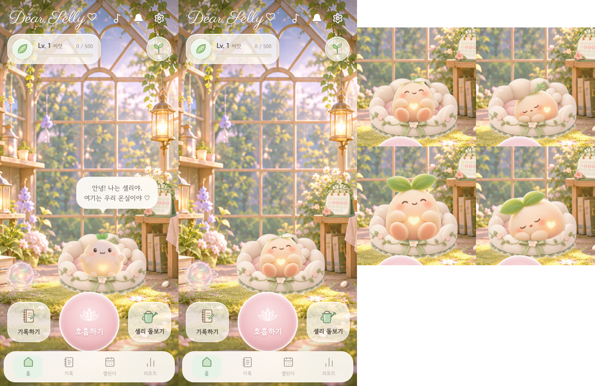

## 9. Phase 6 — 소리 (`src/lib/sound/`)

모든 소리는 Web Audio로 **실시간 합성**해요. 오디오 파일이 없어서 저작권이나 다운로드 걱정이 없어요.

- `engine.ts`: 오디오 컨텍스트 하나, 음악·효과음·호흡 신호 채널, 직접 만든 잔향, 컴프레서
- `music.ts`: **온실 오르골**. Fmaj7 → G6 → Em7 → Am7 패드 위로 펜타토닉 오르골 멜로디가 매번 다르게 흘러요. 호흡 중에는 멜로디가 줄어 차분해져요
- `sfx.ts`: 셀리 효과음
  - 터치 "뿅뿅", 인사 "안녕!", 물 주기(물방울 + "히히"), 햇빛 주기(반짝임), 쓰다듬기("뀨~" + 하트), 칭찬(오르골), 레벨업(팡파르)
  - 매번 음높이가 살짝 달라요
- 효과음은 `react()` 한 곳에서 재생해요. 셀리가 여러 마리 보이는 화면에서도 한 번만 나요
- 휴대폰 브라우저는 **터치가 끝날 때**(touchend/pointerup/click)만 소리를 허락해요. 그래서 그때 소리를 켜고, 실제로 켜질 때까지 터치마다 다시 시도해요. 앱이 백그라운드로 가면 멈추고, 돌아와서 터치하면 다시 켜져요. iOS는 미디어 앱처럼 무음 스위치와 상관없이 재생해요(`audioSession = "playback"`)
- 홈 상단 ♪ 버튼으로 음악을 켜고 꺼요. 설정 → 소리에서 음악과 효과음을 각각 켜고 끄고 볼륨을 조절해요
- 오프라인 렌더링으로 측정한 최대 음량은 효과음 0.34, 음악 0.20이에요(클리핑 없음)

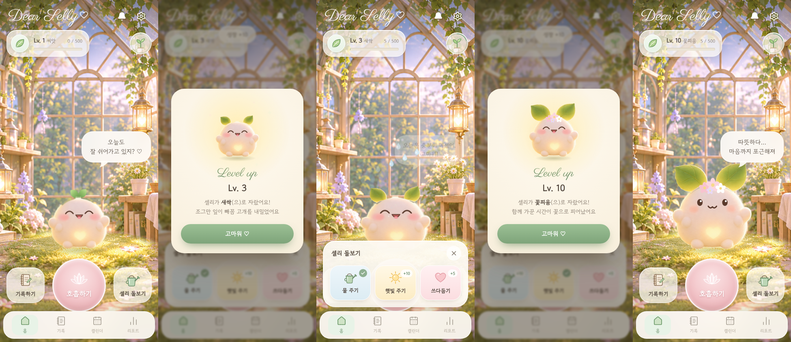
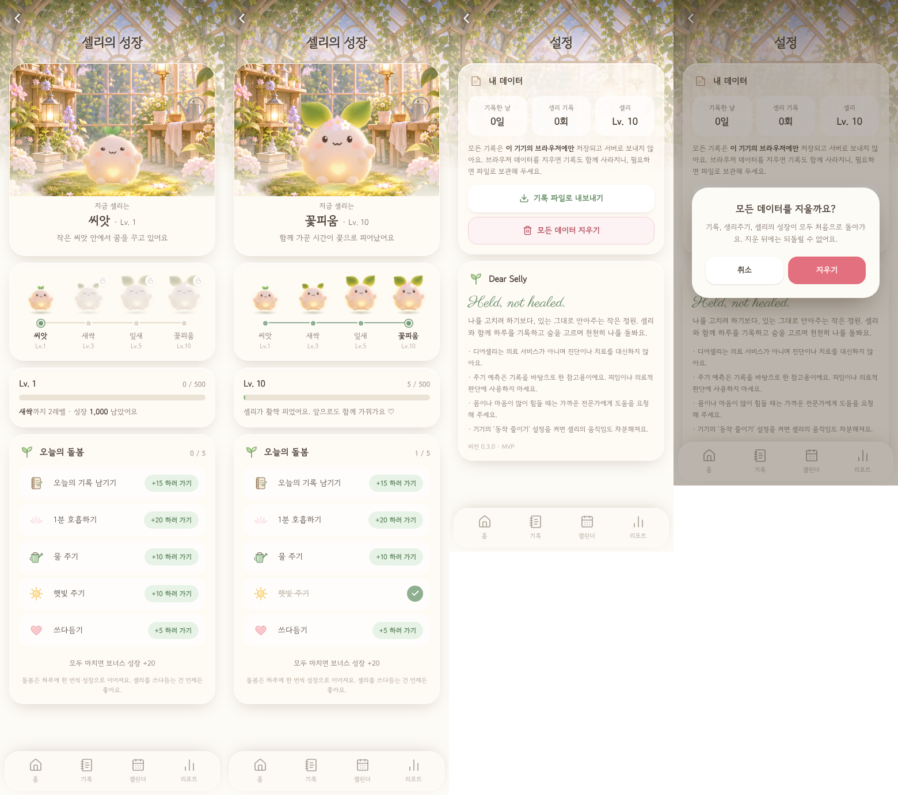

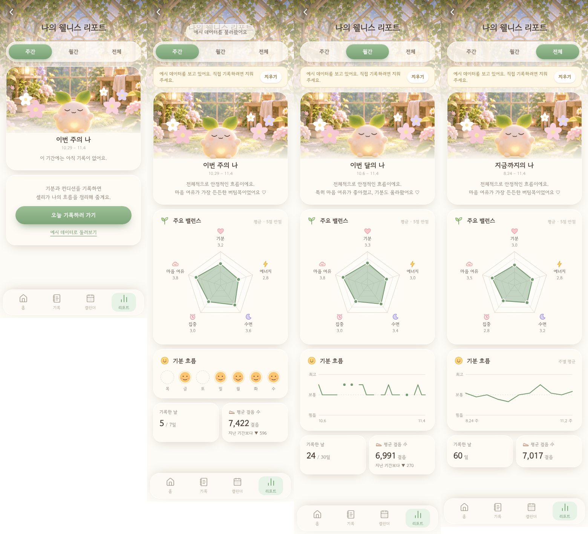
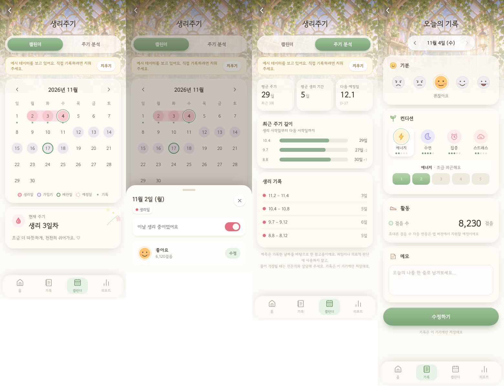

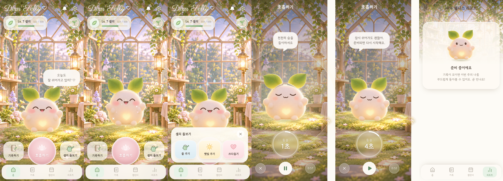
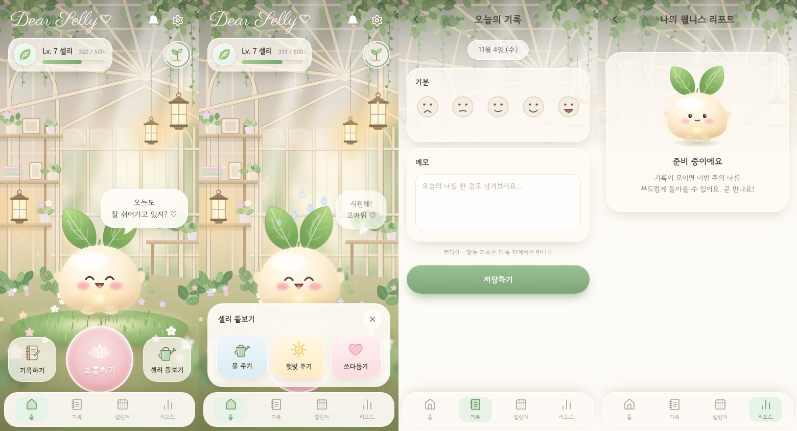


## 11. 셀리와 함께 산책 (웹 1단계)

**흐름:** 온실 문(또는 셀리 메뉴 → 산책하기) → "셀리와 산책할까?"(5·10·15분·자유·다음에) → 셀리가 문으로 걸어가고 문에 빛이 켜진 뒤 페이드 → `/walk` → 시작 카드(처음 한 번 안전 문구) → 산책 → "같이 걸어서 좋았어 ♡" → 요약 → 온실 복귀(꽃잎이 흩날리고, 셀리가 문에서 들어와 쿠션에 앉아요. 발견한 것은 온실 바닥에 놓여요)

| 파일 | 역할 |
| --- | --- |
| `src/components/walk/WalkingScene.tsx` | farBackground · midBackground · foreground 패럴랙스(각자 다른 속도), 시간대별 하늘, ambientParticles |
| `src/components/walk/placeholderArt.tsx` | 코드로 그린 **임시** 레이어(최종 디자인 아님). 이어 붙여도 끊기지 않는 타일 |
| `src/components/walk/WalkingSelly.tsx` | 걷기: `walkArt.frames`가 1장이면 통통 튀는 걸음, 2~4장이면 스프라이트 애니메이션. 멈추면 두리번거리고, 가끔 나비를 따라 봐요. 씨앗 단계는 기본 셀리로 걸어요 |
| `src/components/walk/WalkScreen.tsx` | 시작 카드, 상단 바(남은 시간·감지 상태·주머니 모드·끝내기), 말풍선 선택지, 요약, 주머니 모드(거의 검은 화면, 두 번 탭하면 해제) |
| `src/lib/walk/useWalkSession.ts` | 실제 시계 기준 시간, 이동/멈춤, 셀리의 말(1분 뒤, 이후 3~4분 간격), 끝내기 |
| `src/lib/walk/stepDetector.ts` | 가속도 센서로 걸음 어림. 사용자가 탭할 때만 권한을 요청해요. 거부·미지원·신호 없음이면 **마음 산책**으로 바뀌어요 |
| `src/lib/walk/wakeLock.ts` | Screen Wake Lock(가능할 때). 다시 화면으로 오면 다시 걸어요. 미지원이어도 시간은 계속 흘러요 |
| `src/data/walkingPrompts.ts` | 산책 대사와 선택형 순간(시간대·계절 태그로 확장 가능) |
| `src/lib/game/gameStore.ts` | 발견한 것(꽃잎·작은 돌·씨앗·작은 잎·반딧불이·빛 조각), 복귀 연출 대기 상태 — **웰니스 기록과 분리** |

- **걸음 수 저장:** 감지된 걸음은 "약 n걸음"으로만 보여주고 오늘 기록의 걸음 수에 더해요. 하루 첫 산책(1분 이상)은 성장 +15예요. 목표, 연속 기록, 순위, 부족하다는 표현은 없어요.
- **화면 새로 만들기:** Next 16은 방문한 화면을 상태째 보관해요. 그래서 홈과 산책 화면은 `bfcacheId`를 key로 써서 새로 들어올 때마다 새로 만들어요(`FreshOnNavigate`).

### 산책길 에셋 규격 (`walkArt`, `src/lib/assets.ts`)
| 레이어 | 크기 | 조건 |
| --- | --- | --- |
| far (원경) | 2400×1600 WebP/PNG | 하늘 + 먼 산·호수. 불투명 |
| mid (중경) | 2400×1600 PNG | 나무·덤불·울타리. 지평선(높이의 약 58~62%) 위쪽은 **투명** |
| fore (근경) | 2400×1600 PNG | 산책길·풀·가까운 꽃. 아래 약 40%만 그리고 나머지는 **투명**. 셀리가 걷는 길 표면은 높이의 80~86% |

- 세 장 모두 **왼쪽과 오른쪽 끝이 이어지는 타일**이어야 해요. 세로 화면에서는 한 화면에 약 1/3 폭이 보이고, 계속 반복돼요.
- **걷기 프레임:** 투명 PNG 2~4장, 600px 이상, 같은 캔버스 크기, 오른쪽을 향하고, 발끝 위치가 모든 프레임에서 같아야 해요.

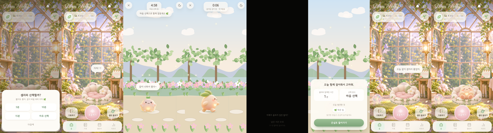


## 12. Phase B — 셀리와 이야기하기

**진입:** 셀리를 터치하면 메뉴(이야기하기 · 쓰다듬기 · 함께 쉬기 · 호흡하기 · 산책하기)가 열려요. '이야기하기'를 고르면 셀리가 왼쪽 앞 대화 자리로 걸어와 나를 바라보고, 상단 바와 하단 버튼은 잠시 숨어요.

**UI** (`src/components/talk/SellyTalk.tsx`): 대화 UI 레퍼런스를 따라 만들었어요.
- "셀리 ♡" 이름표가 달린 큰 말풍선(꼬리는 셀리 쪽)
- 오른쪽에 아이콘이 달린 선택지가 세로로 쌓여요
- 글자는 타이핑되듯 나오고, 탭하면 바로 전체가 보여요. 여러 줄은 차례로 이어져요
- 선택지는 마지막 줄이 끝난 뒤 하나씩 나타나요. 마무리 노드는 "고마워 ♡" 버튼으로 닫혀요. X로 언제든 닫을 수 있어요

**대화 데이터** (`src/data/sellyConversations.ts`): 노드 그래프예요. 대사와 선택지, 행동만 고치면 대화를 늘릴 수 있어요.

| 첫 대답 | 셀리의 반응 | 이어지는 선택 |
| --- | --- | --- |
| ☀️ 기분 좋은 하루였어. | "정말? 나도 덩달아 기뻐! ♡" (기뻐서 폴짝) → "어떤 게 제일 좋았어?" | 작은 일이 잘 풀렸어 / 누군가 다정했어 / 그냥 기분이 좋아 → 기록하러 갈래(기록 화면) · 다음에 할래 |
| 🍃 조금 지쳤어. | "그럼 오늘은 나랑 천천히 쉬자." → **쿠션으로 가서 앉아요** | 짧게 숨 고를래(호흡하기) / 그냥 같이 있을래 |
| ☁️ 마음이 복잡해. | "그럴 때도 있지. 말 안 해도 괜찮아." (하트) | 천천히 숨 쉬어볼래(호흡) / 생각을 적어볼래(기록) / 그냥 옆에 있어줘 → **앞으로 가까이 와요** |
| 🌙 그냥 쉬고 싶어. | "좋아, 아무것도 안 해도 돼." → **쿠션에서 잠들어요** | 조용히 쉴게 / 잠깐 숨 고를래(호흡) |

- 대화 중 셀리의 행동은 두뇌의 `engage`(대화 자리로 오기), `settle`(쿠션에 앉기·잠들기, 가까이 오기), `release`(대화가 끝나면 쉬던 자리에서 조금 더 머물다 다시 혼자 생활하기)가 맡아요
- 선택 내용은 저장하지 않아요. 판단하거나 진단하는 말은 없어요
- 동작 영상: `docs/phaseB-talk-demo.mp4`

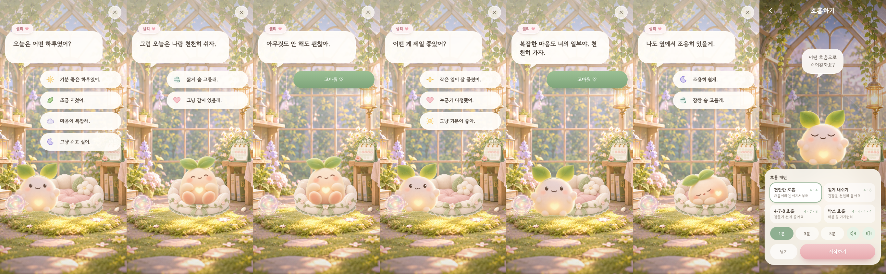


## 13. 시간대별 온실 조명

새 그림 없이 지금 배경 위에 **빛**만 더해요(`src/components/greenhouse/TimeLighting.tsx`). 셀리와 오브젝트 위, 말풍선 아래에 그려서 셀리도 같은 빛을 받아요.

| 시간 | 연출 |
| --- | --- |
| 아침 (5~11시) | 장밋빛이 살짝 돌고, 창으로 비스듬한 햇살 줄기가 천천히 일렁여요 |
| 낮 (11~17시) | 그림 그대로의 따뜻한 자연광 |
| 저녁 (17~21시) | 보랏빛에서 주황으로 넘어가는 노을, 창으로 쏟아지는 노을빛, 랜턴 4개가 켜져요 |
| 밤 (21~5시) | 짙은 남색 어둠에 랜턴 주변만 따뜻하게 빛이 뚫려요. 창으로 은은한 달빛, 반딧불이, 셀리를 따라다니는 작은 빛 |

- 어둠과 빛 구멍은 SVG 마스크 하나로 그려요. CSS 마스크 합성은 브라우저마다 결과가 달라 쓰지 않았어요. 랜턴 위치는 배경 그림에서 밝은 불꽃을 찾아 좌표로 정했어요
- 시간대가 바뀌면 1.2초 동안 천천히 전환돼요. "자동"은 1분마다 시각을 확인해요
- **설정 → 온실 분위기:** 자동(기기 시간) · 아침 · 낮 · 저녁 · 밤. 고른 분위기는 셀리의 자율 행동(아침엔 창가, 밤엔 잠자기), 산책길 하늘, 서브 화면 상단 배경에도 똑같이 적용돼요(`src/lib/game/ambience.ts`)
- 동작 줄이기 설정에서는 햇살 일렁임과 반딧불이가 멈춰요
- 영상: `docs/time-lighting-demo.mp4`

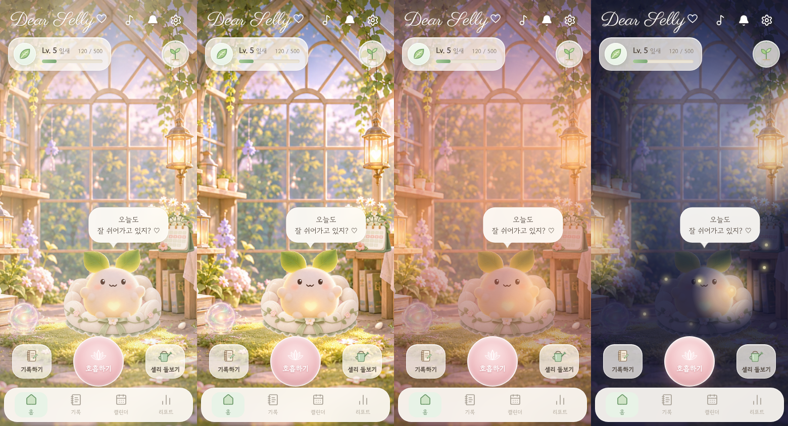


## 14. Phase C — 기분 정원

- **기록 화면의 '마음의 색':** 행복(노란 꽃) · 평온(연두) · 슬픔(파랑) · 불안(보라) · 지침(하양) 중에 고를 수 있어요. 고르지 않아도 돼요. 고르면 그날의 꽃이 온실에 심어져요(`DailyEntry.emotion`, 기록 파일 가져오기에서도 검증해요)
- **성장 규칙** (`src/lib/garden.ts`): 따로 저장하지 않고 기록에서 계산해요. 심은 뒤 하루가 지날 때마다 한 단계, 그 사이 셀리에게 **물을 준 날**마다 한 단계씩 더 자라요. 씨앗 → 새싹 → 꽃봉오리 → 개화. 매일 오지 않아도 시간만 지나면 자라고, **어떤 마음이든 시들거나 어두워지지 않아요**
- **온실 화단:** 오른쪽 앞 기분 꽃 주변에 최근 7송이를 3줄로 엇갈려 심어요. 가장 최근 꽃이 가장 앞이에요. 가장 앞의 '기분 꽃'(터치하면 기록)은 마지막으로 고른 마음의 색으로 피어요. 꽃은 터치를 통과시켜서 셀리와 문 터치를 막지 않아요
- **성장 화면의 '기분 정원' 카드:** 색별 꽃 수와 자라는 중인 꽃 수를 보여줘요. 비교나 점수는 없어요
- **꽃 그림:** 전에 받은 고해상도 하얀 꽃 4단계에서 꽃잎만 다시 칠했어요(`scripts/extract-objects.py`). 잎·꽃술·흙은 원본 그대로이고, 씨앗·새싹은 모든 색이 같은 그림을 써요. 색별 원본 PNG를 받으면 같은 파일 이름으로 바꿔 끼우면 돼요

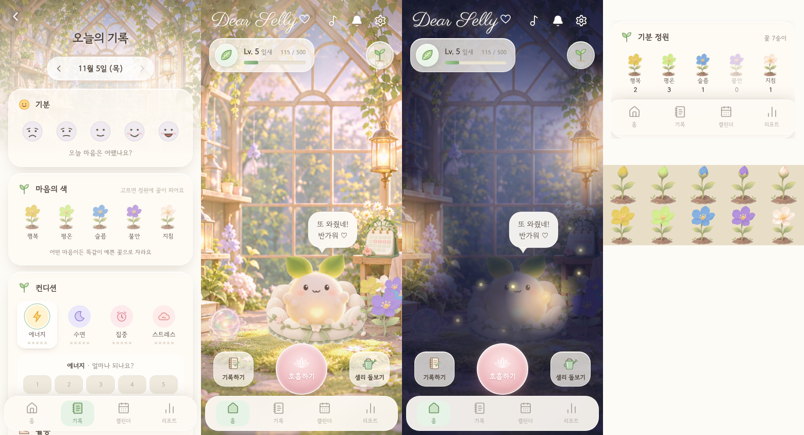


## 15. Phase D — 온실 꾸미기

- **진입:** 홈 상단의 붓 아이콘(온실 꾸미기). 상단 바와 하단 버튼이 숨고, 놓을 수 있는 자리 5곳에 **+** 가 떠요
- **놓기:** 자리를 누르고 아래 트레이에서 아이템을 골라요. 놓인 자리를 다시 누르면 다른 아이템으로 바꾸거나 **치우기**를 할 수 있어요. 완료하면 셀리가 "와, 온실이 더 예뻐졌다 ♡"라고 해요
- **자리** (`src/data/gardenItems.ts` `DECO_SLOTS`): 왼쪽 바닥 2곳, 책 더미 위, 테이블 위(캘린더 옆), 왼쪽 앞(구슬 옆). 쿠션 뒤는 가려져서 쓰지 않아요. 월드 좌표라 화면 크기가 달라도 같은 자리예요
- **아이템** (`DECO_ITEMS`): 지금은 완성된 그림이 있는 것만 쓸 수 있어요. 꽃 모종 5색, 꽃봉오리, 새싹 모종. 꽃 화분 · 덩굴 화분 · 작은 조명 · 쿠션 세트 · 장식 책은 "준비 중"으로 잠겨 있고, PNG를 받으면 `src`만 채우면 바로 열려요
- **저장:** 게임 저장소(`dear-selly:game:v1` → `deco`)에 슬롯 → 아이템으로 저장해요. 웰니스 기록과 분리되어 있고, 나중에 서버로 옮길 때는 `readGame`/`updateGame`만 바꾸면 돼요
- **비용 없음:** 비용이나 해금 조건이 없어요. 압박 없이 마음대로 꾸며요
- 360px 화면에서 상단 아이콘 4개가 들어가도록 로고와 간격을 조정했어요

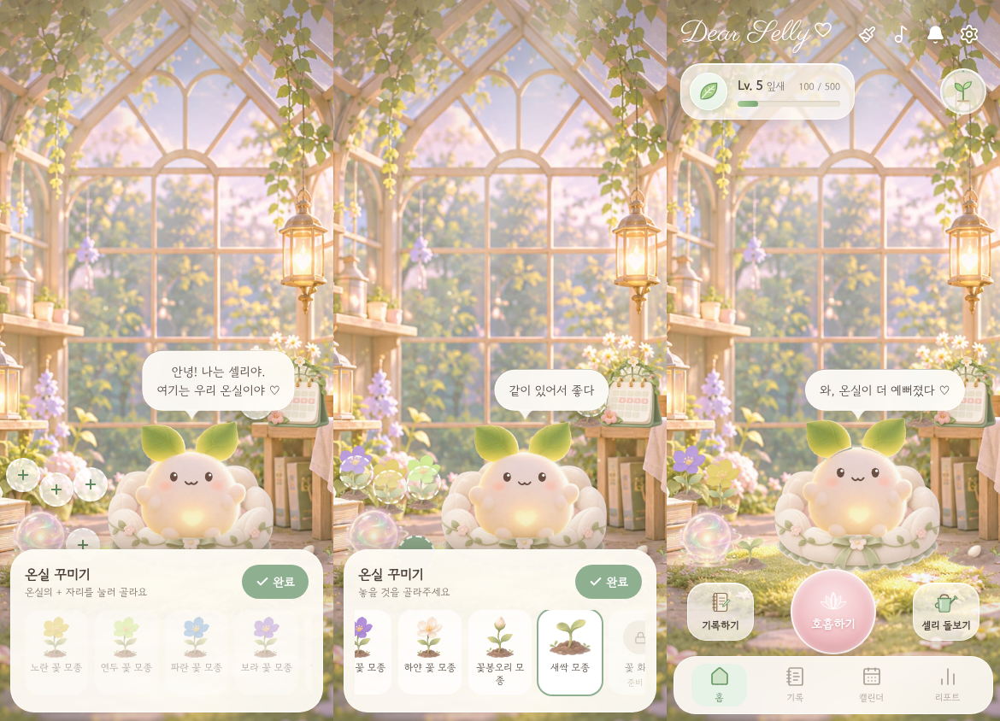


## 16. Phase E — 개인화된 돌봄 제안

- **규칙** (`src/data/careSuggestions.ts`): 위에서부터 처음 맞는 규칙 하나를 보여줘요. 규칙은 데이터만 고쳐서 늘릴 수 있어요.

| 상황 (오늘) | 셀리 | 제안 |
| --- | --- | --- |
| 생리 중 + (지침 / 에너지 낮음 / 기분 낮음) | 오늘은 조금 더 편안하게 쉬어볼까? | 함께 쉬기 · 짧은 호흡 · 조용한 온실 |
| 수면 낮음 | 어젯밤 잠이 좀 부족했구나. 잠깐 같이 쉬어갈래? | 함께 쉬기 · 길게 내쉬기 |
| 불안 / 스트레스 높음 | 마음이 분주한 날이네. 숨을 한 번 길게 내쉬어 볼까? | 길게 내쉬기 · 이야기하기 |
| 슬픔 / 기분 낮음 | 오늘은 내가 곁에 조금 더 있을게. | 이야기하기 · 함께 쉬기 |
| 지침 / 에너지 낮음 | 많이 애썼구나. 오늘은 천천히 가도 돼. | 함께 쉬기 · 조용한 온실 |
| 밤 | 이제 하루를 살며시 내려놓을 시간이야. | 조용한 온실 · 잠들기 전 호흡 |
| 행복 / 기분 높음 (산책 전) | 기분 좋은 날이다! 바람 쐬러 같이 걸을까? | 같이 산책 · 기록하기 |
| 생리 중 (다른 기록 없음) | 오늘은 너에게 필요한 만큼만 해도 괜찮아. | 함께 쉬기 · 짧은 호흡 |
| 생리 예정 2일 이내 | 요즘 몸을 조금 더 따뜻하게 챙겨주자. | 함께 쉬기 · 짧은 호흡 |
| 아직 기록 없음 | 오늘 마음은 어떤 색이야? | 기록하기 · 이야기하기 |
| 아직 호흡 안 함 | 잠깐 숨 고르고 갈래? | 짧은 호흡 |

- **원칙:** 진단, 예측, 판단은 하지 않아요. **주기만으로 기분을 단정하지 않아요.** 기분을 말하는 규칙은 사용자가 직접 기록한 것(마음의 색, 에너지, 수면, 스트레스, 기분)만 써요. 주기 정보만 있을 때는 "필요한 만큼만 해도 괜찮아" 같은 허락의 말만 해요
- **표시** (`src/lib/game/careEngine.ts`): 온실에서 인사 후 약 6초 뒤, 하루 최대 2번(같은 제안은 다시 안 함). 25초가 지나면 저절로 사라지고, "괜찮아"로 닫을 수 있어요. 따르지 않아도 아무 일도 없어요
- **저장:** 게임 저장소에는 "날짜:식별할 수 없는 해시"만 남겨요. 기록 내용이나 주기는 저장하지 않아요. 계산은 모두 기기 안에서 해요
- **조용한 온실 모드:** 밤 조명, 랜턴, 반딧불이에 음악이 차분해지고, 셀리가 쿠션에서 쉬어요. 상단 "🌙 조용한 온실 · 돌아가기"로 나와요
- 호흡 제안은 해당 패턴(편안한 호흡 / 길게 내쉬기 / 4-7-8)을 1분으로 골라 둔 준비 화면을 열어요

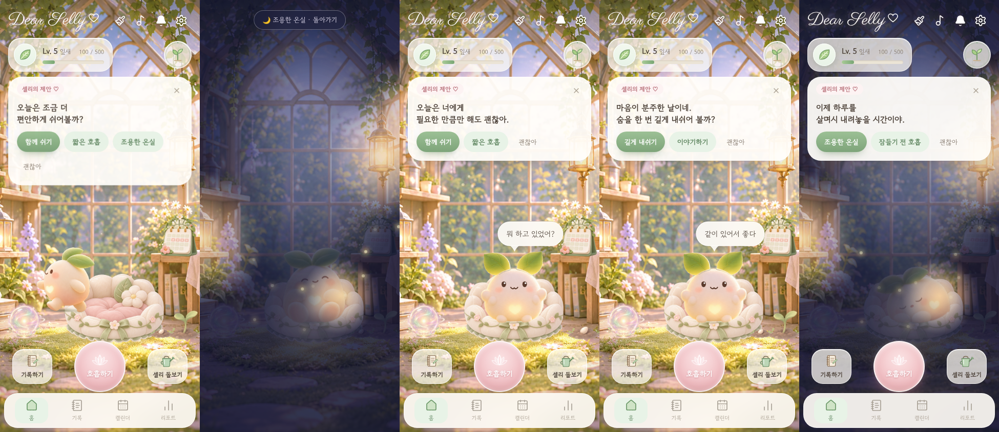


## 17. 온실 나누기 (서버 없이)

**입구:** 성장 화면의 "💌 친구에게 셀리 보여주기", 설정의 "💌 온실 나누기" → `/share`

- **셀리 엽서** (`src/lib/share/postcard.ts`): 1080×1350(4:5) 이미지를 기기 안에서 그려요. 온실 그림 위에 쿠션에 앉은 셀리(성장 단계 크기), 꾸민 장식, (원하면) 기분 꽃, 분위기 조명, 고른 한 마디, 날짜, 레벨이 담겨요. 휴대폰 공유 창이 있으면 카카오톡·인스타 등으로 바로 보내고, 없으면 이미지로 저장돼요
- **온실 구경 링크** (`src/lib/share/snapshot.ts`, `/visit`): 온실 정보를 링크의 `#` 뒤에 담아요(약 200자). `#` 뒷부분은 서버로 전송되지 않아서 저장되는 곳이 없어요. 받은 사람은 앱 없이도 읽기 전용으로 둘러보고, 셀리를 쓰다듬고, "나도 셀리 만나러 가기"로 들어올 수 있어요
- **담기는 것:** 레벨(성장 단계), 꾸미기, 고른 한 마디, 분위기, 그리고 **켰을 때만** 기분 꽃(최근 7송이). 꽃 색이 감정이라 기본은 꺼짐이에요
- **담기지 않는 것:** 기분·컨디션 기록, 걸음 수, 생리주기, 메모. 테스트로 링크 내용에 이 값들이 없는 걸 확인했어요
- **한 마디는 미리 준비된 문장 5개 중에서만** 골라요(`src/data/shareMessages.ts`). 자유롭게 쓰는 글이 없어서 상처 주는 말이 오갈 수 없어요
- **받은 링크는 신뢰하지 않는 입력으로 다뤄요:** 레벨 범위, 슬롯·아이템 이름, 꽃 형식, 시간대, 문장 번호를 검사하고 맞지 않는 값은 버려요. 깨진 링크는 "링크를 열지 못했어요" 안내가 나와요

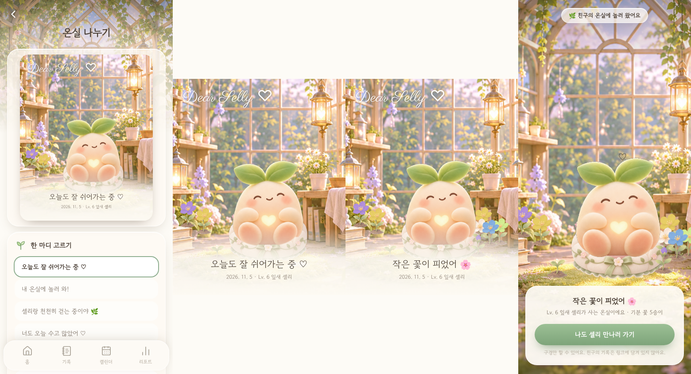


## 18. 친구 기능 (Supabase + 카카오 로그인)

- **서버:** Supabase(`src/lib/supabase/client.ts`). URL과 publishable 키는 원래 공개용이에요. 접근 제어는 `supabase/migrations/`의 Row Level Security가 맡아요
- **원칙:** 웰니스 기록(기분·주기·걸음·메모)은 서버에 **절대** 올리지 않아요. 서버에는 닉네임, 초대 코드, 친구에게 보여줄 온실 모습, 친구 관계, 차단, 선물만 있어요
- **로그인:** 카카오 OAuth(PKCE). 처음 로그인하면 카카오 닉네임을 디어셀리 닉네임으로 가져와요(바꿀 수 있어요)
- **`/friends`:**
  - 로그인 전: 카카오로 시작하기, 저장되는 것과 안 되는 것 안내
  - 로그인 후: 닉네임, 내 초대 코드, 초대 링크(`/friends?add=코드`, 로그인 왕복 중에도 유지), 코드로 친구 추가, 친구 목록(🏡 온실 구경 → `/visit`, 🎁 선물, 친구 끊기·차단), 로그아웃, **계정 삭제**
- **선물** (`src/data/gifts.ts`): 💧 물 주기, 🌱 씨앗, 🌸 꽃잎, ✨ 반딧불이, 🤍 포옹 + 미리 준비된 문장 5개. 자유롭게 쓰는 글은 없어요. 같은 선물은 친구 한 명에게 하루 한 번만 보낼 수 있어요(DB에서 강제)
- **받은 선물:** 온실에 들어오면 셀리가 "OO가 물을 주고 갔어!" 하고 차례로 알려줘요. 씨앗·꽃잎·반딧불이는 온실 바닥에 놓여요. 홈 상단 종 아이콘은 친구 화면으로 가요
- **친구에게 보여줄 온실:** 친구 화면을 열 때마다 레벨과 꾸미기를 갱신해요. 기분 꽃은 **"친구에게 내 기분 꽃도 보여주기"를 켰을 때만** 보여줘요
- **개인정보 처리방침:** `/privacy`. 운영자 연락처 이메일 자리를 채워야 해요
- **Supabase 설정 체크리스트:** migrations 001·002 실행, Kakao provider(REST API 키 / Client Secret / Allow users without an email), URL Configuration(Site URL `https://dear-selly.vercel.app`, Redirect `https://dear-selly.vercel.app/**`)
- **카카오 설정:** 카카오 로그인 ON, Redirect URI `https://<project>.supabase.co/auth/v1/callback`, 동의항목(닉네임 필수, 프로필 사진·이메일 선택), 클라이언트 시크릿 사용


## 19. PMS 관리 — Phase A: 기록 시스템

- **증상 정의** (`src/data/pmsSymptoms.ts`): 감정 5 · 신체 5 · 생활 4개 증상, 일상생활 영향 3개(업무·학업 / 대인관계 / 일상 활동). 모두 0~4 척도(없음 · 가벼움 · 보통 · 심함 · 매우 심함). 본인이 느낀 정도를 적는 기록이고 검증된 임상 척도가 아니에요. 증상별로 따로 저장해서, 나중에 DRSP 같은 검증된 도구를 쓸 수 있게 했어요(매핑은 전문가 검토 후)
- **기록 화면** (`/record` → "PMS 증상" 탭, `?tab=pms`로 바로 열기): 증상마다 한 줄에 0~4 버튼이 있고, 누르면 바로 저장돼요. 같은 점수를 다시 누르면 지워져요. "오늘은 증상이 없어요", 그날 생리 중 표시, 지우기, 날짜 이동으로 지난 기록도 수정할 수 있어요
- **"기록 안 함"과 "증상 없음" 구분:** 기록이 없는 날은 `symptoms`에 항목이 없어요(= 알 수 없음). "증상 없음"은 `none: true`로 따로 저장해요. 0점도 "없음"이라는 명시적인 기록이에요
- **데이터** (`src/lib/data-store.ts`): `symptoms: Record<날짜, { scores, impact, none?, updatedAt }>`, `cycleContext.hormonalContraception`(선택). 기존 저장 데이터는 그대로 두고 새 항목은 비어 있는 채로 붙어요. 내보내기·가져오기에 포함되고, 가져올 때 0~4 범위와 알려진 증상 이름만 받아들여요
- **생리주기:** 실제 기록(생리일)과 예측(점선 표시, 예정일)을 계속 구분해요. 주기 길이 차이가 7일보다 크거나 21~35일을 벗어나면 `irregular`로 보고 "예측이 덜 정확할 수 있어요"라고 안내해요(진단 아님). 호르몬 피임법 사용 여부는 선택 입력이에요
- **서버 보관(선택, 별도 동의)** (`supabase/migrations/002_health_records.sql`, `src/lib/health/sync.ts`, 설정 → "건강 기록 백업"):
  - 기본은 기기에만 저장해요. 로그인한 사용자가 민감정보 처리에 **별도로 동의**해야 `period_days`·`pms_symptom_days`에 올라가요
  - 서버 표는 RLS로 **본인만** 읽고 쓸 수 있어요(동의가 있을 때만 저장 가능). 친구나 관리자가 읽는 경로는 없어요
  - 변경된 날짜만 올리고, 처음 동의하거나 새 기기에서 로그인하면 합쳐요(같은 날짜는 최근 수정이 우선, 생리일은 합집합). 실패해도 기기 기록은 그대로이고 다음에 다시 올려요
  - 동의를 철회하면 `withdraw_health_consent()`가 서버 기록을 모두 지워요. 계정을 삭제하면 cascade로 함께 지워져요
  - 건강 데이터는 로그에 남기지 않아요
- ⚠️ **전문가 검토 필요:** 동의서 문구(법률), 호르몬 피임법 안내 문구(의학), 불규칙 주기 기준(21~35일, 범위 7일 초과)

## 20. PMS 주기 기억 (Phase B)

리포트 › **PMS** 탭과 캘린더에 생리 시작일 기준으로 정리한 증상 기록을 보여줘요. 기록한 내용을 설명할 뿐, 진단하지 않아요.

- 분석 로직: `src/lib/pms/analysis.ts` (규칙은 파일 상단 주석에 적혀 있어요)
  - 직접 기록한 생리 시작일 전 14일(이전 생리와 겹치지 않게 잘림)과 시작 후 +2~+6일을 봐요.
  - 기록하지 않은 날은 계산에서 빠지고, ‘증상 없음’만 0점으로 세요. 생활 영향만 적은 날은 증상 기록으로 치지 않아요.
  - 시작 전 기간에 3일 이상 기록한 주기만 분석하고, 2주기 이상일 때만 주기끼리 비교(중앙값·반복 증상)해요.
  - `expectedPmsDays`: 2주기 이상일 때만, 보통 증상이 시작된 날짜를 다음 예정일에 적용한 **참고용** 기간.
- 셀리 한마디: `src/lib/pms/insight.ts` (무엇이 기록됐는지만 말하고 원인은 말하지 않아요)
- 화면: `src/components/pms/PmsReport.tsx` (주기별 증상 흐름 · 반복 증상 표 · 생활 영향/시작 후 변화 · 안내 문구), 색은 `src/components/pms/colors.ts`
- 캘린더: 증상을 기록한 날에 점수 색 점, 2주기 이상이면 ‘PMS 예상(참고)’ 칸 표시. 주기가 불규칙하면 비교가 덜 정확하다고 알려요.

## 21. 근거 기반 관리 카드 (Phase C)

리포트 › PMS 탭 아래 **‘도움이 될 수 있는 방법’** 카드. 내 기록에 자주 나온 증상을 출처가 직접 언급한 카드가 먼저 보여요(순서만 바뀌고, 모든 카드는 그대로 볼 수 있어요).

- 내용: `src/data/careEvidence.ts` — 출처는 두 곳뿐이에요.
  - NHS “PMS (premenstrual syndrome)” (기관 검토 2024-06-18)
  - ACOG FAQ057 “Premenstrual Syndrome (PMS)” (기관 검토 2025-11)
  - 각 카드에 원문 인용(`quote`)을 함께 저장하고, 화면의 ‘출처 보기’에서 링크와 함께 보여줘요. 출처에 없는 내용은 넣지 않았어요.
  - 약·영양제 **용량은 앱에 쓰지 않아요** (ACOG 원문에 칼슘 용량이 있지만 제외). 대신 ‘먼저 상담하기’ 카드로 안내해요.
  - 모든 카드는 `review: "pending"` → 화면에 ‘전문가 검토 전’ 표시. **공개 전 한국 의료 전문가 검토 필요** (번역·표현·선택).
- 순서 로직: `src/lib/pms/care.ts` (`focusSymptoms`, `pickCare`). 분석할 주기가 2개 미만이면 ‘증상 기록 이어 가기’가 먼저 와요.
- 화면: `src/components/pms/CareCards.tsx` — 펼치기, 앱 안에서 해 보기(산책 `/walk`, 호흡 `/?do=breathe`, 기록), ‘이럴 땐 진료를 고려해 보세요’ 상자.

## 22. 진료 연결 · 안전 (Phase D)

- **진료용 기록 요약** `/report/clinical` (`src/components/pms/ClinicalReport.tsx`, 데이터 `src/lib/pms/clinical.ts`)
  - 생리 기록·주기, 주기별 요약, 일별 점수표(숫자 = 점수, ‘·’ = 그날 기록했지만 이 항목은 평가 안 함, 빈칸 = 기록 없음), 정리 방법을 A4로 정리해요. 최근 2/3/6주기 선택.
  - ‘PDF로 저장·인쇄’ = 브라우저 인쇄(‘PDF로 저장’). 추가 라이브러리 없음. 화면 밖 요소는 `globals.css`의 인쇄 규칙으로 숨겨요.
  - 이 기기의 기록으로만 만들고 어디에도 보내지 않아요. 이름·생년월일은 저장하지 않고 손으로 적는 빈칸으로 둬요.
  - 문서 맨 위에 ‘주관적 자가 기록 · 검증된 척도 아님 · 진단 아님’을 명시해요.
- **진료 준비 카드** (리포트 › PMS): 분석한 주기 중 2번 이상 생활 영향을 ‘심함(3)’ 이상으로 기록하면 NHS·ACOG의 “일상생활에 영향을 줄 때 진료 고려” 안내를 보여줘요.
- **도움받을 곳** `src/components/pms/HelpCard.tsx`, `src/data/safety.ts`
  - 109 자살예방상담전화(24시간·365일·무료) — 보건복지부 보도자료(2026-09-08)로 확인. 119 응급.
  - PMS 리포트 맨 아래에 항상 있어요. 증상 기록에서 우울감·불안을 4(매우 심함)로, 또는 생활 영향을 4로 기록한 날엔 그 섹션 바로 아래에 부드럽게 나타나요(앞쪽 내용이 밀리지 않게).
  - 앱은 자해 여부를 묻거나 위험도를 판단하지 않아요.
- ⚠️ 전문가 검토 필요: 안내 문구, 표시 기준(4점·심함 2주기), 진료 권고 표현. 공개 전 번호 재확인.

## 23. 셀리와 PMS 연결 (Phase E)

셀리는 **사용자가 직접 기록한 것**에만 반응해요. 주기만 보고 기분을 짐작하지 않아요.

- 셀리의 제안 (`src/data/careSuggestions.ts`, `src/lib/game/careEngine.ts`)
  - 오늘 기록한 증상이 ‘심함(3)’ 이상이면: 몸 증상 → 같이 쉬기 / 마음 증상 → 길게 내쉬기 / 피로·수면 → 천천히. 우울감·불안 4점이면 “곁에 꼭 붙어 있을게”.
  - 오늘이 **내 지난 기록상** 증상이 시작되던 시기(2주기 이상, 참고)이고 아직 증상 기록이 없으면: “지난 주기엔 이맘때 피로를 기록했었어. 오늘은 어때?” → 증상 기록 / 같이 산책.
  - 제안은 기존처럼 하루 최대 1~2번, 언제든 ‘괜찮아’로 닫을 수 있어요. 제안 줄은 함수로도 쓸 수 있게 했어요(`line: (c) => …`).
- 이야기하기 (`src/data/sellyConversations.ts`): ‘몸이 좀 불편해.’ 대화 추가 — 아픔 / 피곤함 / 예민함 / 말로 하기 어려움. 셀리는 들어 주기만 하고 몸에 대한 조언은 하지 않아요. ‘증상 기록해 둘래’로 증상 기록 화면에 바로 갈 수 있어요.

## 24. 하루 맥락 온톨로지 (상황 · 상태 · 마음 · 바람)

하루 기록을 쌓였을 때 분석할 수 있는 구조화된 데이터로 남기기 위해, 하루의 맥락을 4개 차원으로 나눴어요. 정의는 한 파일에 있어요: `src/data/contextTags.ts` (`ONTOLOGY_VERSION = 1`).

| 차원 | 그룹 | 붙는 속성 |
|---|---|---|
| 상황 situation (22) | 어디서 · 누구와 · 있었던 일 · 생활 | – |
| 상태 state (9) | 에너지 · 몸 | (+ 기존 컨디션 점수 1–5) |
| 마음 feeling (18) | 활기찬 · 편안한 · 날선 · 가라앉은 | `valence`(쾌/불쾌), `arousal`(높음/낮음), `family`(정원의 5가지 마음색) |
| 바람 need (11) | 몸 · 마음 · 하고 싶은 것 | `action`(셀리가 해 줄 수 있는 것), `selly`(셀리의 말) |

- 마음은 정서의 두 축(쾌·불쾌 × 활성 높음·낮음, circumplex model)으로 4갈래로 묶고, 각 세부 감정은 정원의 5가지 마음색(행복·평온·슬픔·불안·지침)으로 올라가요. → 세부 감정 → 마음색 → 4갈래로 집계할 수 있어요.
- **id 규칙:** 한 번 쓴 id는 바꾸거나 다시 쓰지 않아요. 새 개념은 새 id로 추가해요. 저장된 데이터는 id만 가지고 있고, 의미는 온톨로지에서 찾아요.
- 저장: `AppData.dayTags[날짜] = { tags: id[], updatedAt }`. 기기 + 백업 파일, 그리고 **2026-11-06 판 동의**가 있으면 서버 `day_context` 테이블(마이그레이션 003)에도 보관. 그 전 판에 동의한 사용자는 생리일·증상만 계속 동기화되고, 설정에서 ‘하루 맥락도 백업’에 따로 동의해야 해요(`ConsentState = "partial"`). 서버 RLS도 동의 버전을 확인해요. 백업·서버에서 가져올 때 알려진 id만 받아요(`cleanDayTags`).
- 기록 화면: 하루 기록 탭에 접히는 카드 4개(마음 / 상태 / 상황 / 바람, `DimensionCard`). ‘저장하기’ 때 함께 저장. PMS 증상 탭의 ‘오늘의 상황’은 같은 데이터의 ‘있었던 일 · 생활’ 부분을 바로 저장으로 보여줘요.
- 셀리: 오늘 고른 **바람**이 있으면 셀리의 제안이 그 바람에 답해요 (예: ‘움직이고 싶어’ → “같이 걸으러 갈래?” → 산책). 사용자가 직접 말한 바람이 주기 기반 제안보다 먼저예요.
- 리포트(주간/월간/전체) › **나의 하루 패턴** (`src/lib/dayPatterns.ts`): 마음 4갈래가 나온 날 수, 각 갈래와 같은 날 2일 이상 함께 기록된 상황, 자주 느낀 몸 상태, 자주 원한 것. 맥락을 남긴 날이 3일 이상일 때만.
- 리포트 › PMS › **상황과 함께 본 증상** (`src/lib/pms/tags.ts`): 상황·상태 태그가 있던 날과 다른 날의 증상 점수 비교(최근 6개월, 양쪽 3일 이상). 원인이라고 말하지 않아요.
- 캘린더 날짜 시트에 그날의 증상과 맥락(차원별)이 보여요.

## 25. PMS 미리 보기 — 평소 패턴 · 주기별 돌아보기

매일 기록이 쌓이기 전에도 다음 주기를 짐작할 수 있게, 사용자에게 직접 물어봐요. 증상 항목·0–4 강도는 PMS 증상 온톨로지(`src/data/pmsSymptoms.ts`)를 그대로 써서 매일 기록과 같은 축으로 비교돼요.

- **평소 PMS 패턴 (사전 질문)** `/pms/profile` → `AppData.pmsProfile` — 증상별 강도 + 보통 언제 시작되는지(`ONSET_OPTIONS`: 1~2일 / 3~5일 / 6~9일 / 10일+ 전 / 잘 모르겠어). 리포트·주기 분석 탭에서 언제든 고칠 수 있어요.
- **주기별 돌아보기** `/pms/recap?start=YYYY-MM-DD` → `AppData.cycleRecaps[생리 시작일]` — 매달 다르니까 주기마다 따로. 평소 패턴으로 미리 채워져서 달라진 것만 고치면 돼요. 캘린더에서 생리 시작일을 누르거나, 최근 3주 안에 시작한 주기에 매일 기록이 부족하면 리포트에서 물어봐요.
- **예측** `src/lib/pms/forecast.ts` — 시기와 증상 각각 가장 좋은 출처를 써요: 매일 기록(2주기 이상) → 주기별 돌아보기(최근 3번) → 평소 패턴. 화면에는 항상 ‘○○ 기준’으로 출처를 표시해요. 날짜는 달력 계산 예측 위에 얹은 참고용이고, 주기가 불규칙하면 그렇게 알려요.
  - 리포트 › PMS › **다음 주기 미리 보기**, 캘린더의 ‘PMS 예상(참고)’ 칸, 셀리의 말(“평소엔 이맘때쯤 피로가 있다고 했지” / “지난번엔 …있었다고 했지” / “지난 주기엔 …기록했었어”)이 모두 같은 예측을 써요.
- 진료용 요약 PDF에 ‘사용자가 기억해 답한 패턴’(평소 + 최근 4주기 돌아보기)을 매일 기록과 구분해서 넣었어요.
- 저장: 기기 + 백업 파일(`cleanPattern`으로 검증). 서버 백업에는 아직 포함하지 않았어요.

## 26. 앱인토스(토스 미니앱) 빌드

같은 코드에서 웹 버전과 토스 미니앱 버전을 빌드해요. `NEXT_PUBLIC_PLATFORM=toss`이면 토스용이에요 (`src/lib/platform/index.ts`의 `IS_TOSS`).

```bash
npm run build:toss   # 정적 export(out/) → dear-selly.ait
```

- **설정:** `apps-in-toss.config.ts` — `appName`은 앱인토스 콘솔에 등록한 앱 이름과 **정확히 같아야** 해요(지금 `dear-selly`). 토스 내비게이션 바(뒤로가기·제목), 라이트 테마, 바운스·당겨서 새로고침 끔.
- **정책 대응** (서비스 오픈 정책 · 비게임 출시 가이드 기준)
  - SSR 금지 → 정적 export(`output: "export"`, `trailingSlash`). 토스 빌드에서는 `cacheComponents`/`partialPrefetching`을 꺼요(정적 export와 함께 쓸 수 없음). manifest는 `public/manifest.webmanifest` 정적 파일로 바꿨어요.
  - 로그인은 토스 로그인만 → 카카오 로그인·친구(`/friends`), 서버 백업(HealthSync·동의 카드)을 토스 빌드에서 뺐어요.
  - 자사 사이트로 가는 공유 링크 금지 → 엽서·구경 링크(`/share`, `/visit`)와 진입 버튼을 뺐어요(`NotInToss`).
  - 자사 앱 설치 유도 금지 → PWA 서비스워커·‘홈 화면에 추가’ 안내를 뺐어요.
  - 토스 뒤로가기와 자체 뒤로가기가 함께 보이면 안 됨 → `SubPage`·진료 요약의 자체 뒤로가기 버튼을 숨겨요.
  - 확대·축소 끔(viewport), 라이트 모드.
  - 외부 링크(NHS·ACOG·보건복지부 출처, 109·119 전화)는 `openExternal` → `Device.openURL`.
- **기록 보존:** 토스 웹뷰의 localStorage가 유지된다는 보장이 없어서, 저장할 때마다 토스 기기 저장소(`Storage`)에도 써 두고(`afterPersist` → `startTossMirror`), 시작할 때 먼저 불러와요(`PlatformGate` → `hydrateFromToss`). 토스 앱 밖(샌드박스·브라우저)에서는 localStorage만 써요.
- **기록 파일 내보내기**는 토스에서 `File.saveBase64`로 저장. **진료용 요약 PDF**는 토스에서 인쇄가 안 되므로 화면 보기만 (PDF 저장은 다음 단계).
- 웹 빌드(`npm run build`)는 그대로예요.
